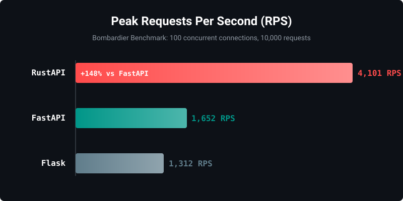

# rustapi

[](https://pypi.org/project/rustapi/)
[](https://pypi.org/project/rustapi/)
[](https://pypi.org/project/rustapi/#files)
[](https://github.com/Piyush4u/rustapi/stargazers)
[](https://github.com/Piyush4u/rustapi#license)
[](https://github.com/Piyush4u/rustapi/actions/workflows/ci.yml)
[](https://github.com/Piyush4u/rustapi/actions/workflows/release.yml)
[](https://github.com/Piyush4u/rustapi#readme)
[](CHANGELOG.md)

**The Django/FastAPI alternative with Rust performance** — A Rust-core Python web framework combining Django's batteries-included approach with FastAPI's modern DX and 2-5x better performance.

## 🎯 Why rustapi?

| Feature | Django | FastAPI | **rustapi** |
|---------|--------|---------|-------------|
| Performance | 🐌 Sync | ⚡ Async | 🚀 **Rust-native (2-5x faster)** |
| Dependency Injection | ❌ | ✅ Depends() | ✅ **FastAPI-compatible** |
| Auto OpenAPI Docs | ❌ | ✅ | ✅ **+ Swagger UI & ReDoc** |
| ORM | ✅ Django ORM | ❌ | ✅ **Django-style async QuerySet** |
| Migrations | ✅ Alembic/Django | ❌ | ✅ **Built-in migration system** |
| Admin Interface | ✅ | ❌ | 🔜 Coming soon |
| Learning Curve | Medium | Low | **Low (FastAPI syntax)** |

<p align="center">
  
</p>

<!-- [PLACEHOLDER for 10-second GIF: Record a terminal session using `vhs` or `Terminalizer` showing `pip install rustapi`, writing a 5 line server, and curling it] -->

> **Status:** Alpha. This is a foundational MVP demonstrating the architecture
> thesis — a Rust-native HTTP engine exposed through a Python decorator API
> with a single FFI hop per request. The full feature set (HTTP/3, async ORM,
> GraphQL, gRPC, native OpenTelemetry) is on the roadmap; see `docs/ROADMAP.md`.

## Install

```bash
pip install rustapi
```

For local development:

```bash
git clone https://github.com/Piyush4u/rustapi
cd rustapi
maturin develop --release
```

## Quick start

```python
from rustapi import RustApi, Request, JsonResponse

app = RustApi()

@app.get("/")
async def index(request: Request):
    return {"hello": "world"}

@app.get("/users/{id}")
async def get_user(request: Request):
    user_id = request.path_params["id"]
    return {"id": int(user_id), "name": "Alice"}

@app.post("/echo")
async def echo(request: Request):
    body = await request.json()
    return JsonResponse({"echoed": body})

if __name__ == "__main__":
    app.run(host="127.0.0.1", port=8080)
```

Run it:

```bash
python app.py
# In another shell:
curl http://127.0.0.1:8080/
curl http://127.0.0.1:8080/users/42
curl -X POST http://127.0.0.1:8080/echo -d '{"msg":"hi"}'
```

## Architecture

```
┌──────────────────────────────────────────────────────────┐
│  Rust engine (single binary, tokio runtime)              │
│  ┌──────────┐  ┌─────────┐  ┌──────────┐  ┌──────────┐  │
│  │ hyper +  │→ │ matchit │→ │  serde   │→ │ hyper    │  │
│  │ tokio    │  │ router  │  │ serialize│  │ response │  │
│  └──────────┘  └─────────┘  └──────────┘  └──────────┘  │
│                       │                                  │
│                       ▼                                  │
│            ┌────────────────────┐                        │
│            │  PyO3 FFI bridge   │  ← single hop per req  │
│            └────────────────────┘                        │
└──────────────────────────────────────────────────────────┘
                       │
                       ▼
┌──────────────────────────────────────────────────────────┐
│  Python layer (thin)                                     │
│  @app.get @app.post ... decorator API                    │
│  user handlers (async or sync)                           │
└──────────────────────────────────────────────────────────┘
```

## What's implemented (v0.1)

### Core Features (v0.2) ✅

- **Rust-native HTTP engine** — hyper + tokio with per-thread persistent event loops (2x throughput)
- **FastAPI-compatible Dependency Injection** — `Depends()`, `Query`, `Path`, `Body`, `Header`, `Cookie`
- **Automatic OpenAPI 3.1 Documentation** — Swagger UI at `/docs`, ReDoc at `/redoc`
- **Django-style Async ORM** — QuerySet API with `.filter()`, `.order_by()`, `.limit()`, `.all()`
- **Built-in Migration System** — Schema detection and application with rollback support
- **simd-json Integration** — 3-10x faster JSON serialization
- **Tower Middleware Stack** — CORS, gzip compression, tracing layers
- **WebSocket Support** — Upgrade handling via tokio-tungstenite
- **HTTP/2 + HTTP/3** — QUIC support via quinn+rustls
- **OpenTelemetry Native** — Auto-instrumented tracing, metrics, structured logging

### Legacy Features (v0.1)

- HTTP/1.1 server via `hyper` + `tokio`
- Radix-tree router via `matchit` (path params, 404 vs 405)
- PyO3 bridge with sync **and** async Python handlers
- `Response` / `JsonResponse` / `TextResponse` types
- `Request` with `method`, `path`, `query_params`, `path_params`, `headers`, `body`,
  `.json()`, `.text()`
- Single-FFI-hop request dispatch

## Roadmap

See `docs/ROADMAP.md` for the full plan. Phase 1 & 2 are complete! 🎉

### Upcoming (v0.3):

- 🔜 Django-style Admin Interface with auto-generated CRUD
- 🔜 Built-in Authentication (JWT/OAuth2/OIDC) with permission classes
- 🔜 Template Engine with hot reload
- 🔜 Background Task Queue with Redis backend
- 🔜 Signals/Events system for decoupled architecture
- 🔜 Internationalization (i18n) with locale management
- 🔜 Comprehensive Caching Framework
- 🔜 `rustapi` CLI (project scaffolding, migrations, benchmarking)

## License

Licensed under the [MIT License](LICENSE-MIT).

Contributions are accepted under the same license unless explicitly
stated otherwise.

## Contributing

See [`CONTRIBUTING.md`](CONTRIBUTING.md). The short version: open an issue
first, fork the repo, run `cargo fmt && cargo clippy && cargo test && python
tests/test_e2e.py` before submitting a PR.

## Security

Found a vulnerability? See [`SECURITY.md`](SECURITY.md). **Do not open a
public issue for security problems.**

## Changelog

See [`CHANGELOG.md`](CHANGELOG.md).

## Publishing

Releases are built by GitHub Actions and published to PyPI via Trusted
Publishing (OIDC). Maintainers: see [`docs/PUBLISHING.md`](docs/PUBLISHING.md)
for setup and the release runbook.
